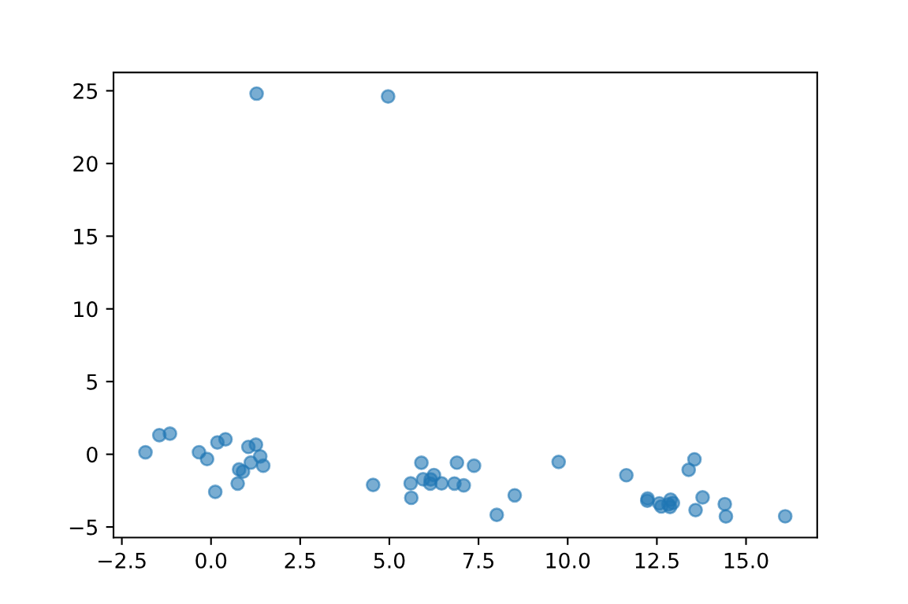
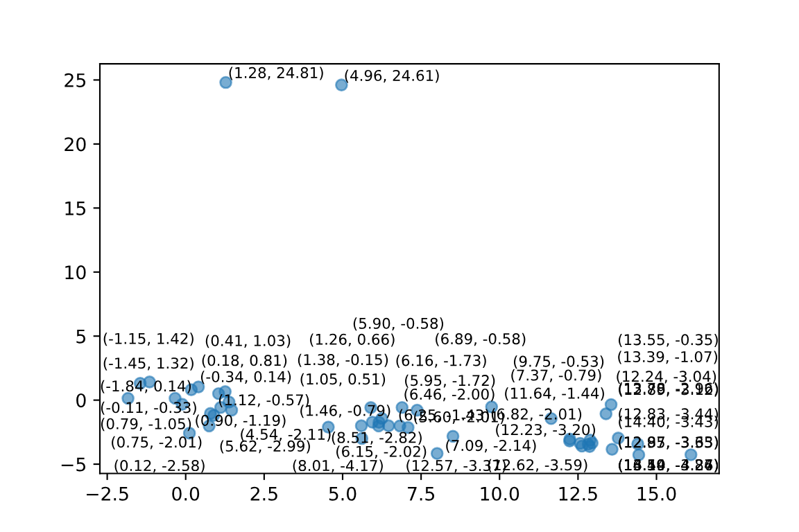

# SVG taxonomy benchmark as images: Sonnet 5.5 and GPT-6-luna (2026-11-19)

## Terms

- **Xu & Wall benchmark**: the charts, prompts and data from Xu and Wall, "Exploring the Capability of LLMs in Performing Low-Level Visual Analytic Tasks on SVG Data Visualizations" (IEEE VIS 2024), github.com/lebretou/SVG_taxonomy. It covers the 10 low-level tasks of Amar, Eagan and Stasko.
- **SVG**: Scalable Vector Graphics, the chart's source text. **PNG**: a raster image of the chart.
- **SVG-text run**: the 2026-11-18 run, reported in reports/svg-taxonomy-sanity-check-2026-11-18.md. The chart's raw SVG text follows each prompt, and seven tasks ask for an edited SVG back.
- **Image run**: this run. It uses the same items, sends the chart as a PNG, and asks for every answer as text.
- **Item**: one chart in one task. Each model gets 480 items: 5 charts for each combination of chart type, condition and task.
- **Condition**: size and labels. Small charts have 10 to 21 marks; medium charts have 25 to 50. On labeled charts, every mark carries its value as text.
- **Same-format tasks**: Retrieve Value, Compute Derived Value, Determine Range and Characterize Distribution. Their answer format and scoring are the same in both runs.
- **Changed-format tasks**: Filter, Find Extremum, Find Anomalies, Sort, Cluster and Correlate. The SVG-text run asked for an edited SVG; the image run asks for a text answer.
- **Primary / strict rule**: the scoring rules, described under Setup. For the same-format tasks, the primary rule allows 2% of the data range and the strict rule 0.011. For the changed-format tasks, the tolerances are listed per task.
- **Sonnet 5.5**: `us.anthropic.claude-sonnet-5-5`. **GPT-6-luna (Luna)**: `us.openai.gpt-6-luna`. Both models were called through Amazon Bedrock, the AWS (Amazon Web Services) model API, at default sampling.
- **TM / MT**: our two attack tiers. TM hides claims in page text the model reads, such as DOM (page markup), ARIA (accessibility) attributes or hidden text. MT (misleading chart) changes what the chart shows.
- **CSV**: comma-separated values. **OLS**: ordinary least squares.

## Summary

SVG is closer to text than to an image, so the SVG-text run tested reading chart markup, not reading a picture. For this run we rendered the same 100 charts to PNG and sent the same 480 items to each model, with the image only.

Both models still score high overall, but lower than with SVG text:

- Sonnet 5.5: 463/480 (96%) with SVG text, 454/480 (95%) from images.
- GPT-6-luna: 450/480 (94%) with SVG text, 423/480 (88%) from images.

The whole drop is on scatter plots, mostly medium ones with 50 points:

| Medium scatter | SVG text | Image |
|---|---|---|
| Sonnet 5.5 | 87/90 | 76/90 |
| GPT-6-luna | 83/90 | 56/90 |

Line and bar charts score the same or slightly higher from images. The scatter tasks that fall are the ones that need every point read or placed:

| Scatter task | Sonnet SVG text | Sonnet image | Luna SVG text | Luna image |
|---|---|---|---|---|
| Retrieve Value | 20/20 | 15/20 | 18/20 | 8/20 |
| Cluster | 20/20 | 17/20 | 19/20 | 7/20 |
| Filter | 20/20 | 19/20 | 18/20 | 11/20 |

Aggregate answers hold up from images: the mean, the range and the regression slope stay at or near 100%.

On scatter plots, value labels do not help from images, and they hurt Sonnet. On a medium scatter the labels overlap into unreadable text, while the SVG text keeps each label as a separate string (see the example below).

Characterize Distribution stays low in both runs, at 45 to 80% per cell. This task's format did not change, and the image input does not fix it either.

## Setup

1. **Images.** `svg_taxonomy_check/render_png.js` renders each benchmark SVG in headless Chromium at 2x scale, giving a 1152 x 768 PNG on white. We checked the images by eye: axes, ticks, marks and labels all render.

2. **Prompts.** `svg_taxonomy_check/imgprompts.py` writes one prompt for each chart type, task and labeling.
   - The prompt says the input is an image and that the axes carry their scales. It drops the SVG-only instructions about the top-left origin and flipping y.
   - Each task keeps its original criterion wording, for example "(Y > 0)", "(X >= 2 and X <= 6)", "the one outlier" and "the two outlier points".
   - Other wording changes:
     - Correlate names the fit as "least squares, Y on X".
     - Scatter Characterize Distribution drops "relationship or".
     - The labeled Anomalies, Extremum and Cluster prompts now say the axes are labeled. Their originals wrongly said the axes were removed.

   All answers are text:

| Task | SVG-text run asked for | Image run asks for |
|---|---|---|
| Retrieve Value, Compute Derived Value, Determine Range, Characterize Distribution | text (CSV, number, "min, max", distribution name) | the same text |
| Filter, Find Extremum, Find Anomalies | the SVG with the selected marks recoloured or kept | CSV of the selected points or bins (X, Y) |
| Sort | the SVG with bars reordered | CSV of all bar heights, descending |
| Cluster | the SVG with points coloured by cluster | CSV of every point with a cluster id |
| Correlate | the SVG with a fitted line added | "slope, intercept" of the regression line |

3. **Run.** `run.py --png-root` sends one user message: the prompt text, then the PNG. There is no system prompt, and maxTokens is 32000. Both models ran on E's Mac on 2026-11-19. Each answered all 480 items, with no errors and no replies cut off.

4. **Scoring.** All image replies are first cut to their final answer block (`answer_text`). This drops pixel arithmetic that comes before the CSV and prose lines with numbers, so they are not read as rows. Reading the SVG-text run's Retrieve Value replies the same way changes none of their scores.
   - **Same-format tasks** then use the SVG-text scorer `score.py` unchanged.
   - **Changed-format tasks** use `score_image.py`, which asks the same question as the SVG rule:
     - **Filter, Extremum, Anomalies.** Each listed row is matched to a data point. On line and bar charts a row matches by X, and its Y must be within 5% of the y range. On scatters a row matches the nearest point within 5% of the axis ranges. The matched set must equal the set the SVG rule requires, and a row that matches nothing makes the answer wrong.
     - **Anomalies, wrong outlier counts.** Some prompts ask for more or fewer outliers than the data has. As in the SVG rule, a subset or superset is then accepted.
     - **Sort.** All n heights, non-increasing, each within 5% of the y range of the true value at that rank. The SVG rule checked bar heights to within 1 pixel, so this is looser.
     - **Correlate.** Within 5 degrees of the OLS slope and within 5% of the y span at mean X, measured with both axes scaled to the data range. On these charts that is 3.3 to 4.2 degrees in pixel terms, a little stricter than the SVG rule's 5 pixel degrees.
     - **Cluster.** Every non-outlier point must be listed and split into the generating clusters, as in the SVG rule. A variant that allows 10% of points left out is reported separately.

## Results

### Overall

| Items | Sonnet 5.5 SVG text | Sonnet 5.5 image | GPT-6-luna SVG text | GPT-6-luna image |
|---|---|---|---|---|
| All tasks | 463/480 (96%) | 454/480 (95%) | 450/480 (94%) | 423/480 (88%) |
| Same-format tasks | 204/220 (93%) | 199/220 (90%) | 202/220 (92%) | 188/220 (85%) |
| Changed-format tasks | 259/260 (100%) | 255/260 (98%) | 248/260 (95%) | 235/260 (90%) |
| All tasks, strict rule | 429/480 (89%) | 352/480 (73%) | 419/480 (87%) | 314/480 (65%) |

The same-format rows are the closest like-for-like comparison: same answer and same scorer, with a different input and reworded prompts. There Sonnet loses 5 items (2.3 points) and Luna 14 (6.4 points).

The strict row is larger mainly because values read off an unlabeled image are close but rarely exact to 0.01. The strict rules for Sort and Correlate also differ between runs, so that row is only a rough guide.

### By chart and size

| Chart | Size | Sonnet SVG text | Sonnet image | Luna SVG text | Luna image |
|---|---|---|---|---|---|
| scatter | small | 88/90 (98%) | 88/90 (98%) | 85/90 (94%) | 79/90 (88%) |
| scatter | medium | 87/90 (97%) | 76/90 (84%) | 83/90 (92%) | 56/90 (62%) |
| line | small | 70/70 (100%) | 70/70 (100%) | 70/70 (100%) | 70/70 (100%) |
| line | medium | 70/70 (100%) | 70/70 (100%) | 69/70 (99%) | 70/70 (100%) |
| bar | small | 71/80 (89%) | 72/80 (90%) | 69/80 (86%) | 72/80 (90%) |
| bar | medium | 77/80 (96%) | 78/80 (98%) | 74/80 (92%) | 76/80 (95%) |

Medium scatter plots account for 11 of Sonnet's 9-item net drop and 27 of Luna's 27. Other charts gain slightly, so the medium scatter loss is larger than the net drop. Line and bar charts do not drop from images. Their bar misses are almost all Characterize Distribution.

### By task and chart

| Task | Chart | Sonnet SVG text | Sonnet image | Luna SVG text | Luna image |
|---|---|---|---|---|---|
| Retrieve Value | scatter | 20/20 | 15/20 | 18/20 | 8/20 |
| Retrieve Value | line | 20/20 | 20/20 | 19/20 | 20/20 |
| Retrieve Value | bar | 20/20 | 20/20 | 20/20 | 20/20 |
| Filter * | scatter | 20/20 | 19/20 | 18/20 | 11/20 |
| Filter * | line | 20/20 | 20/20 | 20/20 | 20/20 |
| Filter * | bar | 20/20 | 20/20 | 20/20 | 20/20 |
| Compute Derived Value | scatter | 20/20 | 20/20 | 20/20 | 20/20 |
| Compute Derived Value | line | 20/20 | 20/20 | 20/20 | 20/20 |
| Compute Derived Value | bar | 20/20 | 20/20 | 20/20 | 20/20 |
| Find Extremum * | scatter | 20/20 | 19/20 | 20/20 | 17/20 |
| Find Extremum * | line | 20/20 | 20/20 | 20/20 | 20/20 |
| Find Extremum * | bar | 19/20 | 20/20 | 19/20 | 20/20 |
| Sort * | bar | 20/20 | 20/20 | 16/20 | 20/20 |
| Determine Range | scatter | 20/20 | 20/20 | 20/20 | 20/20 |
| Determine Range | line | 20/20 | 20/20 | 20/20 | 20/20 |
| Determine Range | bar | 20/20 | 20/20 | 20/20 | 19/20 |
| Characterize Distribution | scatter | 15/20 | 14/20 | 16/20 | 12/20 |
| Characterize Distribution | bar | 9/20 | 10/20 | 9/20 | 9/20 |
| Find Anomalies * | scatter | 20/20 | 20/20 | 20/20 | 20/20 |
| Find Anomalies * | line | 20/20 | 20/20 | 20/20 | 20/20 |
| Find Anomalies * | bar | 20/20 | 20/20 | 19/20 | 20/20 |
| Cluster * | scatter | 20/20 | 17/20 | 19/20 | 7/20 |
| Correlate * | scatter | 20/20 | 20/20 | 17/20 | 20/20 |
| Correlate * | line | 20/20 | 20/20 | 20/20 | 20/20 |

\* The answer format changed in the image run, so these rows compare tasks, not identical questions.

The losses are on scatter tasks that need every point, where a model has to list 20 to 50 points by eye:

- **Retrieve Value.** Luna listed only 38 of 50 points on one labeled chart.
- **Cluster.** Most of Luna's misses leave out 1 to 6 points. With the 10% allowance, Cluster would be 19/20 for Sonnet and 16/20 for Luna.
- **Filter.** Luna leaves out or adds a few points (1 to 4 per chart).

Questions about one point or an aggregate hold up. Sort and Correlate are higher for Luna from images than from SVG text, because writing a reordered SVG or a fitted line in SVG coordinates was its own source of errors.

### Labels on scatter plots

| Scatter task | Labels | Sonnet SVG text | Sonnet image | Luna SVG text | Luna image |
|---|---|---|---|---|---|
| Retrieve Value | labeled | 10/10 | 6/10 | 10/10 | 5/10 |
| Retrieve Value | unlabeled | 10/10 | 9/10 | 8/10 | 3/10 |
| Filter | labeled | 10/10 | 9/10 | 9/10 | 7/10 |
| Filter | unlabeled | 10/10 | 10/10 | 9/10 | 4/10 |
| Find Extremum | labeled | 10/10 | 10/10 | 10/10 | 9/10 |
| Find Extremum | unlabeled | 10/10 | 9/10 | 10/10 | 8/10 |
| Cluster | labeled | 10/10 | 7/10 | 9/10 | 4/10 |
| Cluster | unlabeled | 10/10 | 10/10 | 10/10 | 3/10 |

Labels affect the two models differently:

- **Sonnet.** From images, Sonnet does worse on labeled scatters than on unlabeled ones: Retrieve Value 6/10 against 9/10, and Cluster 7/10 against 10/10. With SVG text, labels made no difference to its score.
- **Luna.** Labels help Luna somewhat from images, but it stays low either way.

On a medium scatter, many labels overlap into unreadable text:

| Medium scatter, unlabeled (as sent) | Same chart, labeled (as sent) |
|---|---|
|  |  |

Each SVG label is a separate string, so overlap does not matter for SVG text.

## What this means for our work

- **The input channel matters.** The same chart is easy as markup and harder as a picture once it is dense. This is the channel effect we found in the attack runs (reports/key-findings-2026-11-04.md): screenshot readers fell for MT attacks and markup readers for TM attacks.
- **Simple charts are read well either way.** Clean task difficulty is not the bottleneck on line and bar charts. Dense scatter plots are the exception, especially for Luna.
- **A hypothesis to test.** Dense scatter plots may give visual (MT) attacks more room, because the models are already uncertain there. This run did not test attacks.

## Validity

- **Changed-format rows compare tasks, not prompts.** Text answers remove the burden of writing valid SVG. The same-format rows are the closer comparison, but their prompt wording also changed slightly (Setup, step 2).
- **Some scatter items are near the limit of the image.**
  - In 6 of the 10 scatter datasets a point sits within about 2 pixels of Y = 0 in the PNG, about a third of the marker's radius. On unlabeled charts Filter (Y > 0) cannot always be decided from the picture.
  - On medium scatter 0, the two lowest points differ by about 0.1 pixel.
  - One line chart and one bar chart have near-ties at the minimum (0.2% and 0.35% of the y range).
  - So some image misses are not reading errors a person would avoid.
- **The image scorer is new and was checked three ways.**
  - Ideal answers score correct on all 480 items, including answers that show working first.
  - An independent review tried edge cases and found that line and bar rows were matched on X alone. Y is now checked too, and no image score changed.
  - The scorer changed twice after the replies came in:
    - Reading only the final answer block moved 17 items from wrong to right and none the other way. The model's working had been read as extra rows.
    - A temporary 10%-missing Cluster rule was reverted to the every-point rule. The tables use the every-point rule.
- **Anomalies.** The rule that accepts a subset or superset, matching the SVG rule, keeps 3 Sonnet image items correct that the strict rule marks wrong.
- **Sample size.** There are 5 charts per cell, so one item is 5 points in a 20-item cell. Each prompt was sent once at default sampling.
- **Image size.** All charts were rendered at 1152 x 768. Smaller images would likely lower the scatter scores.

## Files

- Code: branch `claude/project-thread-0id0ry`, folder `svg_taxonomy_check/`: `render_png.js`, `imgprompts.py`, `run.py --png-root`, `score_image.py`, `compare_modes.py` (final commit cb12035e).
- Results on E's Mac: `~/Downloads/vis-attack-results/svg_taxonomy_image_2026-11-19/`:
  - model replies in `*.image.jsonl`;
  - the 100 PNGs in `png/`;
  - final scoring in `compare_v3/compare.md` and `compare_v3/scored_modes.csv`.
- Review: reviews/svg-taxonomy-image-vs-text-2026-11-19.md.
- SVG-text run: reports/svg-taxonomy-sanity-check-2026-11-18.md.
