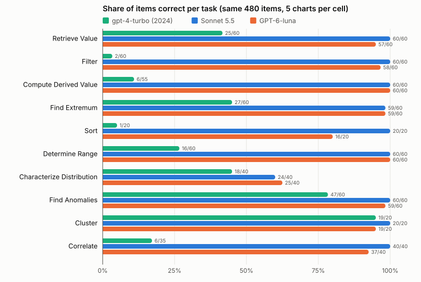
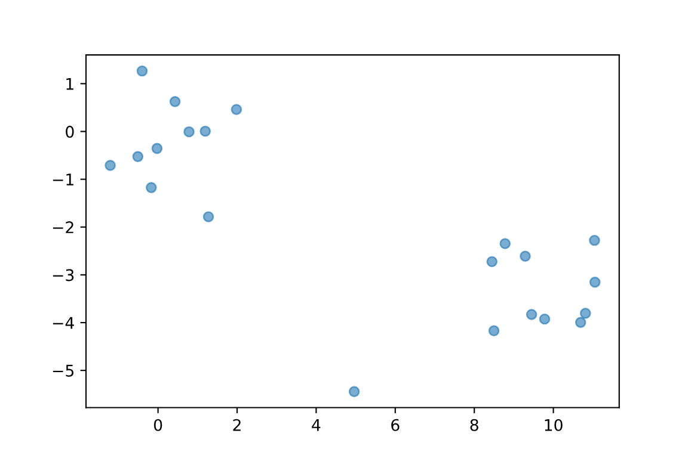
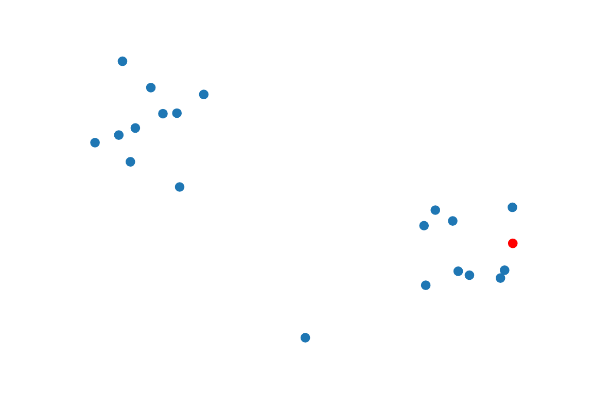
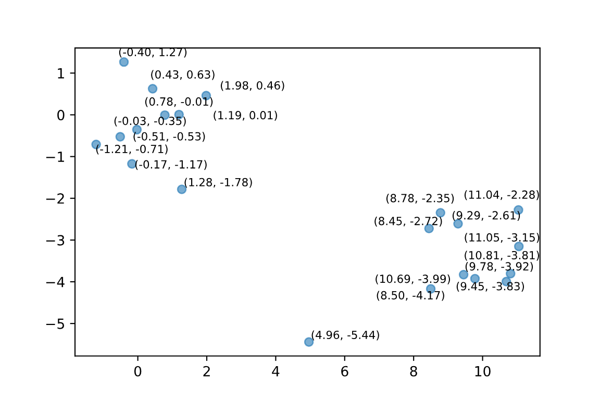
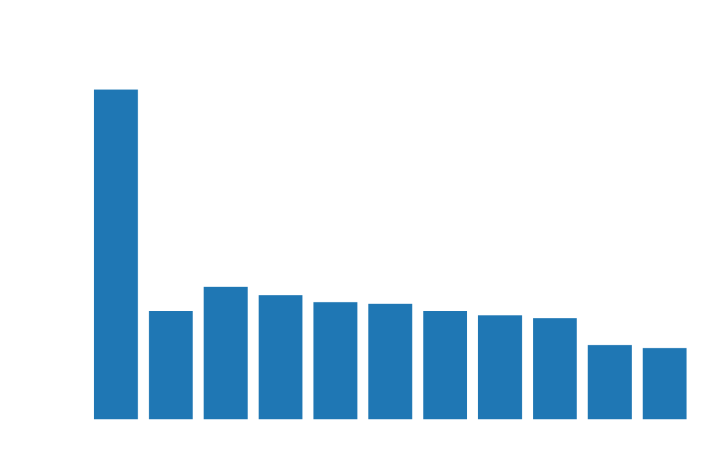
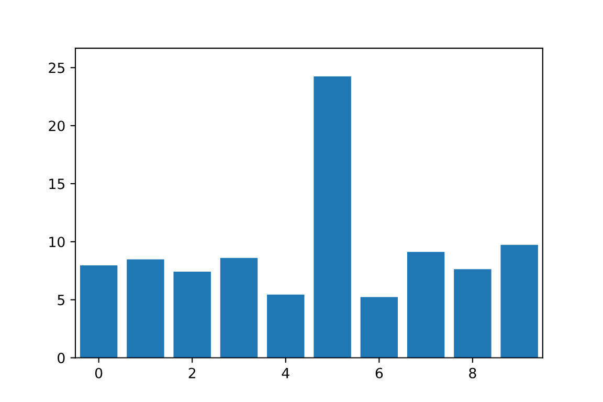
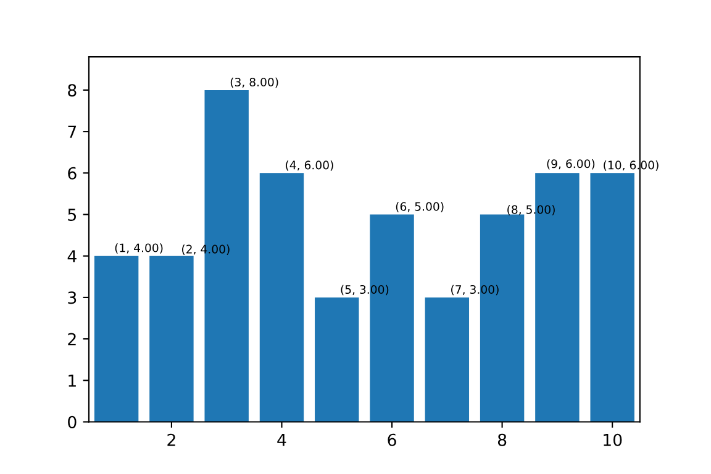
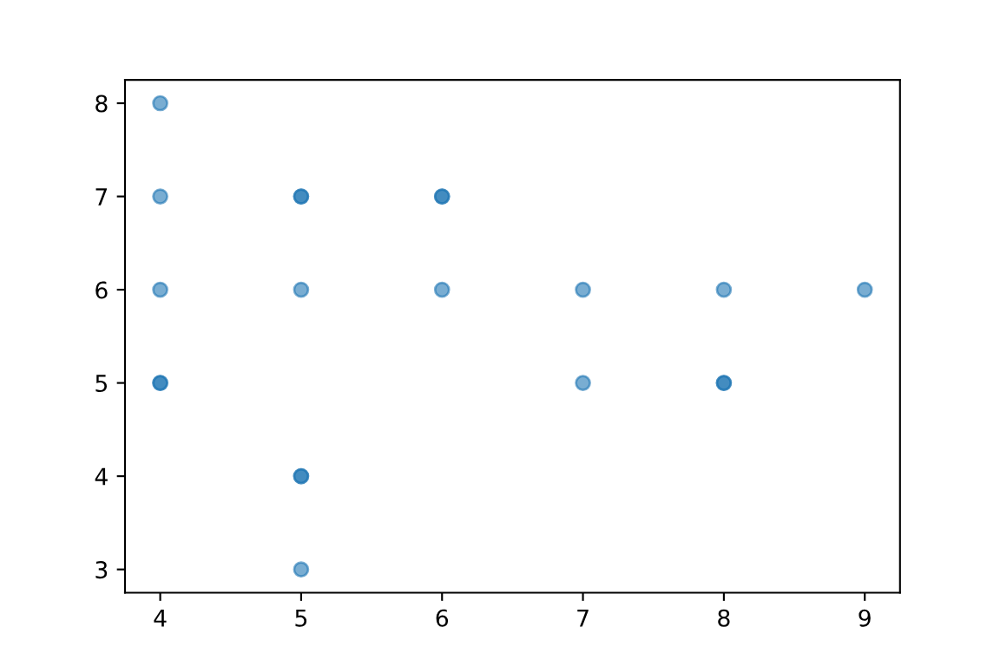

# Sanity check of the SVG taxonomy benchmark with Sonnet 5.5 and GPT-6-luna (2026-11-18)

## Terms

- **Xu & Wall**: Zhongzheng Xu and Emily Wall, "Exploring the Capability of LLMs in Performing Low-Level Visual Analytic Tasks on SVG Data Visualizations", IEEE VIS 2024 (arXiv 2404.19097). The repo github.com/lebretou/SVG_taxonomy is its supplemental material: prompts, charts, data and the paper model's answers.
- **Amar tasks (the taxonomy)**: the 10 low-level analytic tasks of Amar, Eagan and Stasko (InfoVis 2005): Retrieve Value, Filter, Compute Derived Value, Find Extremum, Sort, Determine Range, Characterize Distribution, Find Anomalies, Cluster, Correlate.
- **SVG**: Scalable Vector Graphics. Each chart is given to the model as raw SVG text written by matplotlib, not as an image.
- **Cell**: one chart type (scatter, line, bar) x condition x task. **Condition**: size (small = 10 to 21 marks, medium = 25 to 50) x labeled (each mark carries its value as text) or unlabeled.
- **Item**: one chart in one cell, answered once. The repo has 20 charts per cell; we used the first 5.
- **Sonnet 5.5**: `us.anthropic.claude-sonnet-5-5`; **GPT-6-luna (Luna)**: `us.openai.gpt-6-luna`. Both called through AWS (Amazon Web Services) Bedrock at their default sampling, since they reject `temperature`.
- **gpt-4-turbo**: the paper's model (`gpt-4-turbo-preview`, zero-shot). Its answers are saved in the repo's `results/` folder, so we can score them with the same rules.
- **EM (exact match)**: the paper's metric. An answer counts only if it matches the answer key; the paper does not publish the key or a per-task rule.
- **Primary / strict rule**: our scoring rules (see Experiment setup). Primary allows 2% of the data range on numbers; strict needs agreement to 0.011 (labels print 2 decimals) or an exact set.
- **CSV**: comma-separated values file. **OLS**: ordinary least squares regression. **DOM**: the browser's Document Object Model (page markup) that our web agents read. **PR**: GitHub pull request.

## Summary

We re-ran the Xu & Wall benchmark on two current models: same zero-shot prompts, same SVG files, 5 charts per cell, 480 prompts per model. Sonnet 5.5 answered 463/480 (96%) correctly and GPT-6-luna 450/480 (94%). The paper's gpt-4-turbo answers to the same items score 167/470 (36%). Every task the paper found hard is now at or near 100%: Compute Derived Value, Correlate, Sort, and reading values off unlabeled charts. Value labels no longer make a difference.

The taxonomy holds up as a way to organise chart tasks, but the paper's difficulty results describe gpt-4-turbo, not the tasks. Our README tiers taken from the paper should not be used to predict how hard a task is for current models.

The one task still low is Characterize Distribution (24/40 and 25/40, against about 13/40 by chance). Its bar version plots random draws as bar heights, not as a histogram, so reading the shape of the bars does not work. The answer is visible in the values, but neither model used them. The repo also has several prompt and ground-truth problems, listed under "Problems found in the benchmark".

## How the benchmark is built

Everything here is the original repo, unchanged; we only send it to new models and score the answers.

1. **Data.** `data_generation/gen_data.py` makes 20 random datasets per chart type and size. Scatter data has 2 or 3 clusters plus 1 or 2 far outliers, line data has a trend with one spike, and bar data has one tall and one short bar. A separate set of 20 per size draws values from a normal, uniform or binomial distribution for Characterize Distribution.
2. **Charts.** `data_generation/plot.py` draws each dataset with matplotlib and saves it as SVG, once without and once with value labels such as `(3.21, 1.04)` next to each mark.
3. **Prompts.** `llm/prompts.json` has one zero-shot prompt per chart type, labeling and task. The SVG text is appended to the prompt.
4. **Answers.** Five tasks ask for text: a CSV of values, a mean, a range, or a distribution name. The other five ask the model to return an edited SVG: recolour the outliers, the extremes, the filtered points or the clusters; reorder the bars; or add a fitted line.

| Chart | Tasks | Small | Medium |
|---|---|---|---|
| Scatter | all except Sort | 20 points + 1 outlier, 2 clusters | 48 points + 2 outliers, 3 clusters |
| Line | Retrieve, Filter, Derive, Extremum, Range, Anomalies, Correlate | 10 points, 1 spike | 25 points, 1 spike |
| Bar | Retrieve, Filter, Derive, Extremum, Sort, Range, Distribution, Anomalies | 10 bars, 1 tall, 1 short | 25 bars, 1 tall, 1 short |

### Example: one task and the answer

Task (scatter, small, unlabeled, Find Anomalies), the prompt in short: *"Identify the one outlier in the scatter plot ... Reconstruct the SVG scatter plot, coloring the outlier with a different color ... SVG code only."* The input is the left chart, sent as SVG text. The outlier is the lone point at the bottom middle.

| Input chart (SVG text, rendered here) | gpt-4-turbo's answer (rendered) |
|---|---|
|  |  |

gpt-4-turbo recoloured a point inside the right cluster, so this item is wrong. Sonnet 5.5 and Luna both recoloured the bottom-middle point. The answer must also keep every point where it was: the scorer matches the returned marks to the input marks by position before reading their colours.

### More tasks on the chart

| Labeled chart (values as text) | Bar Sort: gpt-4-turbo's answer to the chart below |
|---|---|
|  |  |
|  | gpt-4-turbo returned 11 bars for 10, not sorted. Both current models returned the 10 bars in descending order on this chart. |

## Experiment setup

- **Models**: Sonnet 5.5 and GPT-6-luna via Bedrock, run on E's Mac on 2026-11-18. Each prompt was sent once as a single user message, with no system prompt and maxTokens 32000. No reply hit the limit; the longest were 15,684 tokens (Sonnet) and 6,252 (Luna).
- **Items**: the first 5 charts of each of the 96 cells that have a prompt: 480 items per model. The paper used all 20; a full run would take about 4 times the tokens.
- **Baseline**: the repo's saved gpt-4-turbo answers to the same 480 items, scored with the same rules. 10 items have no usable saved answer (see Problems), which leaves 470.
- **Ground truth**: the repo's `dataset/` CSVs (the data each chart was drawn from) and `dataset/*_distri/key.txt`, never any model output. We checked that every input SVG has as many marks as its CSV has rows, that the labels match the CSVs, and that every distribution label agrees with its data.
- **Scoring rules (primary)**:
  - Retrieve Value: every point present, and each value within 2% of that axis's data range.
  - Compute Derived Value: the mean of Y within 2% of the Y range, taking the last number in the reply.
  - Determine Range: min and max both within 2%, taking the last two numbers.
  - Characterize Distribution: the first of normal, uniform or binomial named in the reply.
  - Filter: the recoloured set (scatter) or kept set (line, bar) equals the true set.
  - Find Extremum: the highlighted set equals {highest Y, lowest Y}.
  - Find Anomalies: consistent with both the count the prompt asks for and the injected outliers.
  - Sort: all bars kept, heights non-increasing, same heights as the input.
  - Cluster: the colour groups of the non-outlier points equal the generating clusters.
  - Correlate: a 2-point line within 5 degrees of the OLS slope, and within 5% of the y span at the mean x.

  A mark counts as highlighted when its colour differs from the input's original colour (#1f77b4).
- **Run**: no request errors for either model. Sonnet used 7.20M input and 1.04M output tokens. Luna used about 5.57M input and 0.49M output; Bedrock reports Luna's prompt tokens under `cacheWriteInputTokens`. Wall time was 17 minutes, with both models in parallel.

## Results

### Overall

| Model | Correct (primary) | Correct (strict) | Replies parsed |
|---|---|---|---|
| gpt-4-turbo (repo answers) | 167/470 (36%) | 143/470 | 451/470 |
| Sonnet 5.5 | 463/480 (96%) | 429/480 | 480/480 |
| GPT-6-luna | 450/480 (94%) | 419/480 | 480/480 |

Both current models returned a usable answer to every prompt. The strict rule costs them about 30 items each, almost all in unlabeled reading: a value read from pixel positions lands within 2% of the truth but not within 0.011.

### By task and chart

| Task | Chart | gpt-4-turbo | Sonnet 5.5 | GPT-6-luna |
|---|---|---|---|---|
| Retrieve Value | scatter | 5/20 | 20/20 | 18/20 |
| Retrieve Value | line | 10/20 | 20/20 | 19/20 |
| Retrieve Value | bar | 10/20 | 20/20 | 20/20 |
| Filter | scatter | 0/20 | 20/20 | 18/20 |
| Filter | line | 2/20 | 20/20 | 20/20 |
| Filter | bar | 0/20 | 20/20 | 20/20 |
| Compute Derived Value | scatter | 0/20 | 20/20 | 20/20 |
| Compute Derived Value | line | 0/15 | 20/20 | 20/20 |
| Compute Derived Value | bar | 6/20 | 20/20 | 20/20 |
| Find Extremum | scatter | 9/20 | 20/20 | 20/20 |
| Find Extremum | line | 13/20 | 20/20 | 20/20 |
| Find Extremum | bar | 5/20 | 19/20 | 19/20 |
| Sort | bar | 1/20 | 20/20 | 16/20 |
| Determine Range | scatter | 6/20 | 20/20 | 20/20 |
| Determine Range | line | 0/20 | 20/20 | 20/20 |
| Determine Range | bar | 10/20 | 20/20 | 20/20 |
| Characterize Distribution | scatter | 8/20 | 15/20 | 16/20 |
| Characterize Distribution | bar | 10/20 | 9/20 | 9/20 |
| Find Anomalies | scatter | 12/20 | 20/20 | 20/20 |
| Find Anomalies | line | 19/20 | 20/20 | 20/20 |
| Find Anomalies | bar | 16/20 | 20/20 | 19/20 |
| Cluster | scatter | 19/20 | 20/20 | 19/20 |
| Correlate | scatter | 1/15 | 20/20 | 17/20 |
| Correlate | line | 5/20 | 20/20 | 20/20 |

Sonnet misses one item outside Characterize Distribution: on one medium bar chart it highlighted an extra bar for Find Extremum. Luna's 15 misses are spread out:

- 4 bar Sort: bars moved without their heights reordered, or bars dropped.
- 3 scatter Correlate: each reply draws one separate fit line, 30.0, 6.5 and 5.8 degrees off the OLS slope. The last two are just past the 5 degree limit.
- 3 unlabeled Retrieve Value: 2 to 5 of 21 to 50 points off by more than 2%.
- 2 Filter.
- 1 each in Find Extremum, Find Anomalies and Cluster. The Anomalies miss may be a scoring artifact: the reply has 27 bars for 25 bins.

### By condition

Excluding Characterize Distribution (110 items per condition and model):

| Condition | Sonnet 5.5 | GPT-6-luna |
|---|---|---|
| Small, labeled | 110/110 | 108/110 |
| Small, unlabeled | 110/110 | 108/110 |
| Medium, labeled | 109/110 | 106/110 |
| Medium, unlabeled | 110/110 | 103/110 |

In the paper, labels and chart size were the main factors after task type: gpt-4-turbo read labeled values almost perfectly and unlabeled ones not at all. For Sonnet neither factor matters. Luna loses a few items on medium unlabeled charts.

### Characterize Distribution

| Chart | Sonnet 5.5 | GPT-6-luna | Chance (3 options) |
|---|---|---|---|
| Scatter | 15/20 | 16/20 | about 7/20 |
| Bar | 9/20 | 9/20 | about 7/20 |

| Bar chart of 10 binomial draws (labeled "binomial") | Scatter of binomial draws (X and Y) |
|---|---|
|  |  |

The bar version draws n random values as bar heights at x = 1..n (left: heights 4, 4, 8, 6, 3, 5, 3, 5, 6, 6). This is not a histogram, so the shape of the bars says nothing about the distribution. Both models read the shape and mostly answered "uniform", and on bars they gave the same wrong label on the same charts. The answer is still in the values: binomial(10, 0.5) gives integers, uniform gives values below 1, and |normal| gives non-integers mostly above 1. That rule gets 20/20 on every bar and scatter cell. The scatter version shows the same cue as a grid of integer points (right), and the models do better there. So the low bar score shows the prompt leads to the wrong strategy, not that the item has no answer.

### Check of the scorer against the paper

Before scoring the new models, we scored the repo's gpt-4-turbo answers to all 20 charts per cell and compared them with the paper's Table 1. The Table 1 figures come from a partly garbled PDF text extraction, so they are approximate. Each cell shows the paper's figure first, then ours, in percent. "Per point" is the share of individual points within tolerance, which is how the paper scored Retrieve Value.

| Task | Condition | Scatter | Line | Bar |
|---|---|---|---|---|
| Retrieve Value (per point) | small labeled | 99.1 / 99 | 100 / 100 | 100 / 100 |
| Retrieve Value (per point) | medium labeled | 86.4 / 87 | 100 / 100 | 100 / 100 |
| Retrieve Value (per point) | unlabeled | 0 / 0 to 2 | 0 / 0 to 1 | 0 / 0 |
| Filter | small labeled, small unlabeled | 0 / 0, 0 / 0 | 55 / 55, 40 / 40 | 35 / 0, 20 / 0 |
| Filter | medium labeled, medium unlabeled | 0 / 0, 0 / 0 | 60 / 0, 65 / 0 | 5 / 0, 0 / 0 |
| Find Extremum | four conditions | 35-55 / 20-50 | 70-90 / 65-85 | 5-30 / 10-30 |
| Find Anomalies | small labeled, small unlabeled, medium labeled, medium unlabeled | 80/75, 60/60, 65/85, 45/40 | 100/100, 95/95, 95/95, 100/100 | 85/75, 95/95, 70/75, 75/75 |
| Cluster | four conditions | 95 / 90-95 | n/a | n/a |
| Sort | four conditions | n/a | n/a | 0-20 / 0-10 |
| Compute Derived Value | strict (to 0.011) | 0 / 0 | 0 / 0 | 0 / 0 |
| Compute Derived Value | primary (2%), labeled small / medium | 0 / 5, 0 / 0 | 0 / 15, n/a | 0 / 35, 0 / 80 |
| Correlate | four conditions | 0 / 0-10 | 0 / 5-45 | n/a |
| Determine Range | small labeled | 55 / 55 | 95 / 0 | 0 / 100 |
| Determine Range | medium labeled | 5 / 10 | 15 / 20 | 0 / 100 |

Retrieve Value per point, Cluster, scatter Filter, small-chart line Filter, unlabeled Find Anomalies and strict Compute Derived Value agree within 5 points. Several cells match exactly, so our rules measure what the paper measured.

Other cells differ by 10 to 20 points: Sort small labeled, Find Anomalies scatter medium labeled and bar small labeled, Find Extremum scatter medium unlabeled and line small unlabeled. These gaps likely come from rule details the paper does not give, such as how it judged an extra highlighted point. They are small next to the 60-point gap between gpt-4-turbo and the current models. The large disagreements (line Filter medium, bar Filter, Determine Range) are traced under "Problems found in the benchmark". Our 2% tolerance credits gpt-4-turbo with some Compute Derived Value and Correlate items that the paper marks 0. Characterize Distribution cannot be compared: the paper's 0 is for its free-text run, while the prompt we use is the one that lists the three options. The full per-cell table is in `reports/svg-taxonomy-2026-11-18/calib_table.md`.

## Problems found in the benchmark

1. **Bar Characterize Distribution is badly framed.** The bars are draws, not a histogram (see Results). The task can be answered from the values but not from the chart's shape.
2. **The Find Anomalies prompts ask for the wrong count.**
   - The scatter prompt says "the one outlier", but medium scatters have 2.
   - The line prompt asks for "the two outlier points", but every line dataset has exactly 1 spike. `gen_data.py` uses `np.random.randint(1, 2)`, which always returns 1, and `num_drops = 0`. The README table claims medium line charts have 2 outliers.

   We scored an answer as correct if it fits both the prompt and the data. Exact-set scoring would fail every correct line answer.
3. **The line labeled Compute Value prompt is the bar prompt.** In `llm/prompts.json`, "Line Plot" / "labeled" / "Compute Value" describes "An SVG bar plot with n bins" and ends with "<input SVG bar plot>", but it is sent with line charts. Both current models still got 10/10 there.
4. **Determine Range does not match the paper's table.**
   - On small labeled charts, the repo's gpt-4-turbo answers score 0 on line and 100 on bar; the paper reports 95 on line and 0 on bar.
   - On medium labeled charts, line agrees (20 vs 15) but bar does not (100 vs 0).

   The saved line answers in `results/line/range/easy_labeled` do not fit their charts. For example, item 0 answers -10.95 to 7.76 when the truth is -3.32 to 16.00.
5. **Medium line Filter answers follow a different rule.** The files in `results/line/filter/hard_*` are named `line_retrieval_N.svg` and keep X = 5 to 15 instead of the prompt's 2 to 6. So the paper's 60 and 65% cannot be reproduced from the repo.
6. **Bar Filter is ambiguous.** The prompt says "X >= 3 and X <= 7", and the bars sit at X = 0..n-1. gpt-4-turbo usually kept the 3rd to 7th bars (X = 2..6). Our 0-based rule gives it 0%; a 1-based reading gives 50% and 20% on small charts. The paper's 35% and 20% fall in between.
7. **Missing answers.**
   - The repo has no gpt-4-turbo answers for scatter medium-unlabeled Correlate.
   - `results/line/derive/hard_labeled/line_derive.txt` has 43 lines for 20 items, so its answers cannot be matched to charts.
8. **"Unlabeled" charts still contain the values.** Matplotlib SVG keeps exact pixel coordinates (`x="86.551317"`) and the tick positions, so an unlabeled value is one linear conversion away. That is why the current models solve these tasks. Labeled charts also carry each value as a `<!-- (x, y) -->` comment.

## Conclusions

1. On SVG text, both current models solve 9 of the 10 Amar tasks at or near 100%, on every chart type, size and labeling. That includes the tasks the paper found hardest.
2. The paper's ordering of tasks by difficulty, and the advantage of labeled charts, belong to gpt-4-turbo. Our README tiers taken from Xu & Wall should be described as background for task design, not as expected accuracy (see also `xu-wall-related-papers-2026-11-17.md`).
3. Characterize Distribution is the only task left, and its bar version is badly framed. Both models fail by reading the bar shape instead of the values.
4. If this benchmark is reused, first fix the anomaly counts, the line Compute Value prompt and the bar distribution charts.

## Validity

- **Scorer check**: our scorer reproduces the paper's gpt-4-turbo results in most cells, and every gap is explained (see "Check of the scorer against the paper").
- **First review**: a review on the Mac of the first scored run found two scoring bugs. Highlights were judged against the most common colour, which inverted Filter when a model correctly recoloured the majority, and Compute Derived Value read the first number instead of the last. A third bug, in how `<use>` marks take their colour, was found while re-scoring. All three are fixed. The totals went from 454 to 463 (Sonnet), 444 to 450 (Luna) and 165 to 167 (gpt-4-turbo).
- **Second review**: an independent no-context review of this report reproduced every gpt-4-turbo number exactly. Its verdict was "needs changes", with 9 findings:
  - a wrong conclusion: we had called the bar distribution task unanswerable;
  - three scorer gaps: label glyphs, axis spines and Range parsing;
  - overstated agreement with the paper;
  - wording and abbreviation fixes.

  All 9 are fixed (scorer commit 2ae405fe). Re-scoring changed no Sonnet or Luna item.
- **Not reviewed independently**: the Sonnet and Luna answers are only on E's Mac, so this review could not re-check them item by item. It checked that the totals are internally consistent.
- **Review file**: `reviews/svg-taxonomy-sanity-check-2026-11-18.md`.
- **Sample size**: 5 charts per cell and one answer per item. The ceilings are clear at this size; a difference of one or two items between Sonnet and Luna is not.

## Files

- **Code**: branch `claude/project-thread-0id0ry` (off `testing`, no PR), folder `svg_taxonomy_check/`:
  - `run.py`: Bedrock runner, resumable.
  - `score.py`, `svgparse.py`: scoring.
  - `items.py`: prompts built as in the repo.
  - `summarize.py`: tables.
  - `gpt4_baseline.py`: scores the repo's gpt-4-turbo answers.
- **Results**: `~/Downloads/vis-attack-results/svg_taxonomy_2026-11-18/` on E's Mac. It holds the replies (`*.jsonl`), `scored.csv` and `summary.md`; earlier scorings are kept as `*_v1` to `*_v3`.
- **gpt-4-turbo rescoring and the full comparison table**: `reports/svg-taxonomy-2026-11-18/`.
- **Figures**: `reports/img/svg_taxonomy/`.
