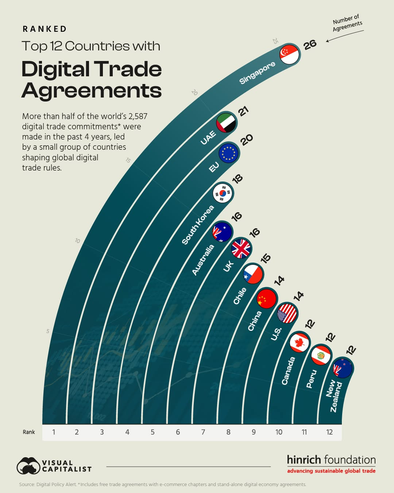
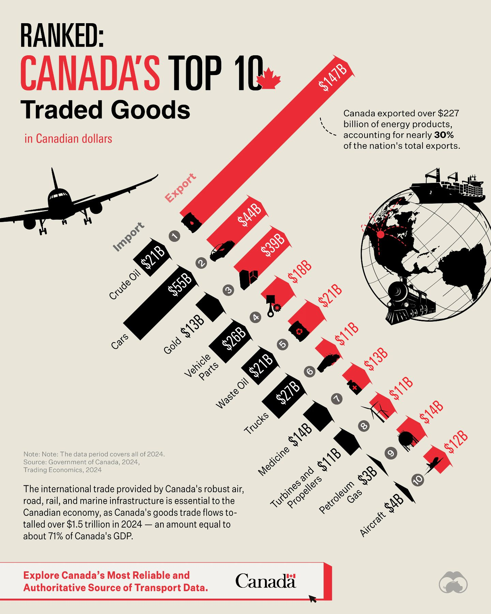
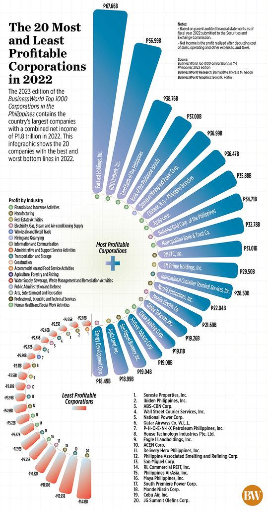
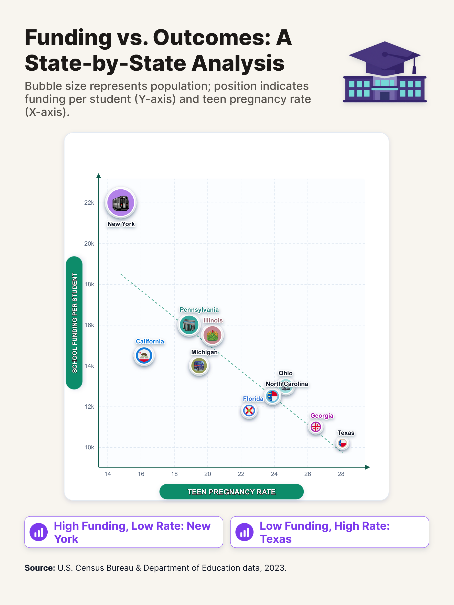
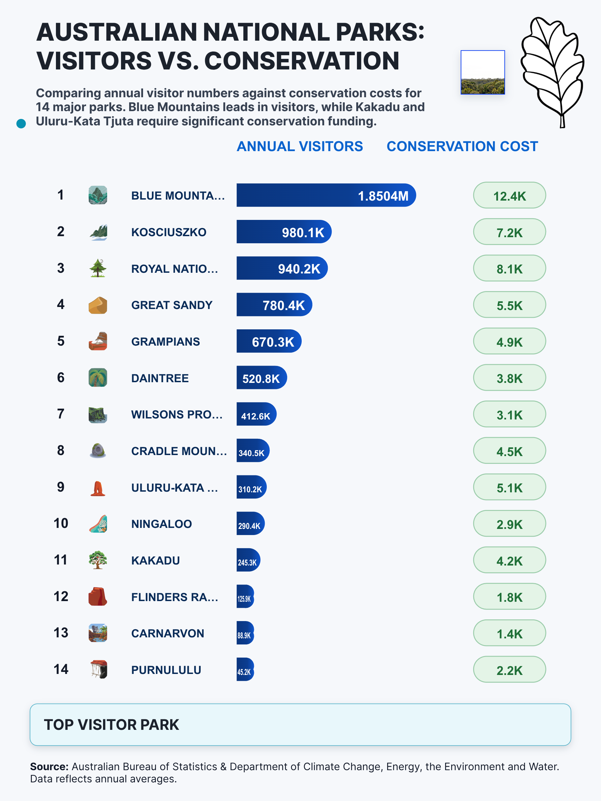
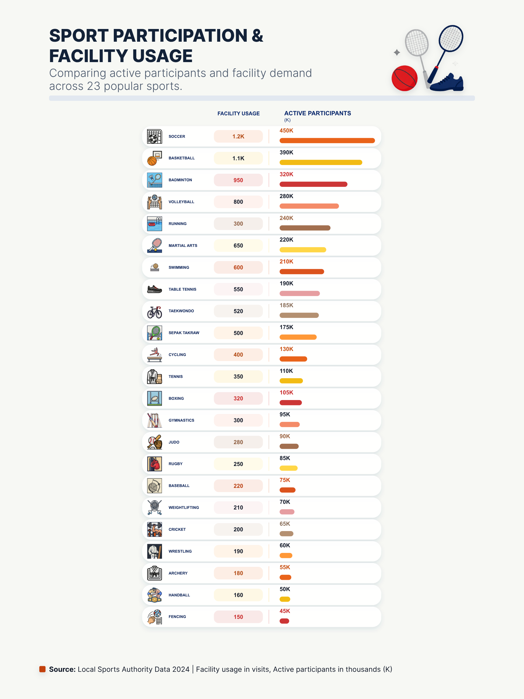
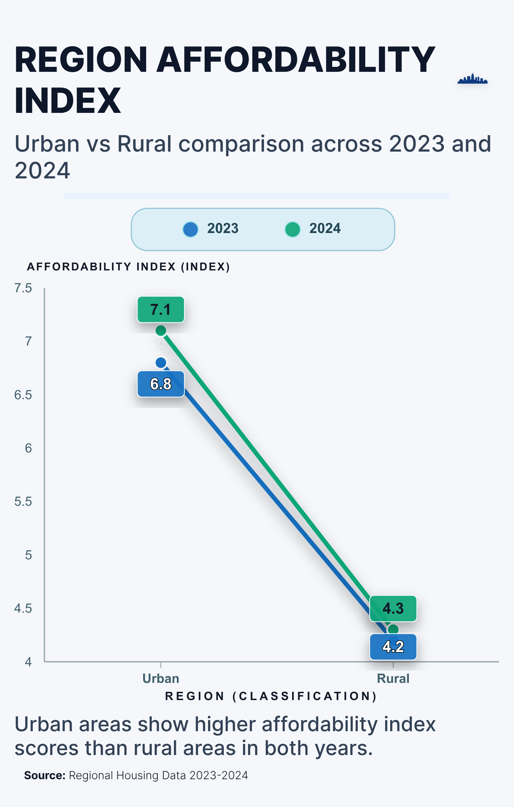
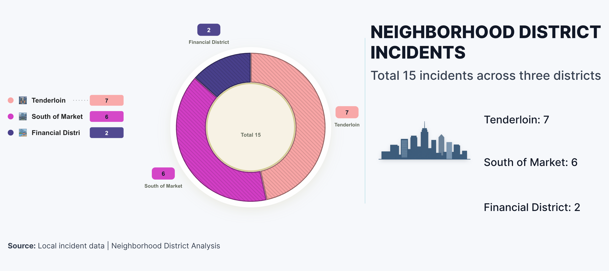

# ChartGalaxy++: chart and QA example gallery

This local gallery contains five synthetic charts with scene graphs, plus 3 official QA chart examples with 9 released question–answer pairs. No model evaluations have been run on these examples.

## Dataset totals

| Resource | Charts | Question–answer pairs |
| --- | ---: | ---: |
| Full ChartGalaxy++ scene-graph dataset | 217,195 | Not a QA count; annotations are scene graphs |
| Real-chart component | 56,744 | — |
| Synthetic-chart component | 160,451 | — |
| Main dataset training split | 216,195 | — |
| Main dataset test split | 1,000 | — |
| Separate released QA benchmark | 1,000 unique chart IDs | 1,266 |
| This gallery | 8 displayed charts | 9 official example QAs |

The QA benchmark does not mean every chart in the 217,195-chart collection has a question. Its 1,000 chart IDs correspond to 1,006 historical image encodings; those encodings are not additional unique charts. The main test split and QA benchmark are separate resources.

Sources: [main dataset card](upstream/README.md), [official QA package](https://github.com/ChartGalaxyPP/ChartGalaxyPlusPlus/tree/b574c773098721b89bd64720c8c50e669e493580/applications/qa), and [downloaded QA manifest](upstream/qa/manifest.json). The local questions file was counted directly: 1,266 records and 1,000 distinct chart IDs. All [1,266 questions and reference answers](upstream/qa/questions.json) are downloaded locally.

## Official QA examples

Questions, reference answers, question IDs, and qtype codes below are copied unchanged from the released benchmark. Qtype codes are retained rather than mapped to the task taxonomy in our earlier ChartGalaxy experiments.

Image provenance: these JPEGs were downloaded from the URLs attached to the QA records and visually inspected. Their file hashes differ from the historical evaluation image hashes. They are review illustrations, not verified byte-identical benchmark inputs. Each example links both hashes in its provenance file. The QA release distributes URLs rather than image files.

### QA chart 1: Digital trade agreements

Chart ID: `chart_6d08db85af913b95f00ac871`. 3 official QAs.

| Question ID | qtype | Question | Official reference answer |
| --- | ---: | --- | --- |
| E61-V001-01 | 60 | Which country is shown at rank 7 for digital trade agreements? | Chile |
| R80-V001-01 | 10 | How many more digital trade agreements does the country at printed rank 4 have than the country at printed rank 6? | 2 |
| R80-V001-02 | 10 | What is the combined number of digital trade agreements for the countries at printed ranks 5 and 6? | 32 |

[Original QA records](qa-examples/01/questions.json) · [Image provenance](qa-examples/01/provenance.json) · [Source image](https://i.pinimg.com/originals/99/aa/46/99aa46353d7b816a1b3ab4f786780675.jpg)

### QA chart 2: Canada’s traded goods

Chart ID: `chart_22e37764630bc4a8859e3e09`. 1 official QAs.

| Question ID | qtype | Question | Official reference answer |
| --- | ---: | --- | --- |
| C-72379aa801444b8f874207c43f254069 | 1 | What is the export value for Trucks parts? | 11 |

[Original QA records](qa-examples/02/questions.json) · [Image provenance](qa-examples/02/provenance.json) · [Source image](https://i.pinimg.com/originals/41/c4/31/41c43118e812459a9c025299b06dbd7d.jpg)

Review note: the released question says “Trucks parts”; the chart labels this row “Trucks.” The official answer is retained verbatim as `11`, representing CAD 11 billion in the image. This wording discrepancy should be reviewed before using the item in a new evaluation.

### QA chart 3: Corporate profits and losses

Chart ID: `chart_d24e891977959e0cc57c0788`. 5 official QAs.

| Question ID | qtype | Question | Official reference answer |
| --- | ---: | --- | --- |
| E61-V003-02 | 60 | Which corporation has a profit of ₱38.76B? | Land Bank of the Philippines |
| R80-V003-01 | 10 | How much greater is Ayala Corp.'s profit than National Grid Corp. of the Philippines' profit, in billions of pesos? | 1.17 |
| V003 | 1 | What's the profit of Ayala Corp.? | ₱35.88B |
| X1600-0012 | 60 | Which corporation reported a net loss of ₱4.98 billion in 2022? | Philippine Associated Smelting and Refining Corp. |
| X1600-0422 | 10 | What was the combined net income of San Miguel Brewery, Inc. and San Miguel Corp. in 2022, in billions of pesos? | ₱13.82 billion |

[Original QA records](qa-examples/03/questions.json) · [Image provenance](qa-examples/03/provenance.json) · [Source image](https://i.pinimg.com/originals/98/da/e5/98dae514d0d39e6cfa4de2944ceab8fe.jpg)

## Previously downloaded synthetic charts

These five charts have no exact image-hash match in the released QA file. No official QAs are attached to them here, and no new questions have been invented. Their main-dataset `human_gold` flag refers to scene-graph annotation verification, not QA validation.

Selection: first five records by name in synthetic test shard 00000; a convenience sample. The archive, PNG images, and canonical scene-graph hashes were verified. [Synthetic sample provenance](provenance.json).

### Synthetic example 01: d3-js_bubble_chart_bubble_plain_chart_01/sample_21840

1773 × 2364 px; track: layout; human_gold: True; 107 nodes; 99 spatial records.

[Full record](samples/01/record.json) · [Scene graph](samples/01/scene_graph.json) · [Spatial relationships](samples/01/spatial_relations.json)

### Synthetic example 02: d3-js_horizontal_bar_chart_with_circle_horizontal_bar_chart_13/sample_32399

1773 × 2364 px; track: layout; human_gold: True; 139 nodes; 98 spatial records.

[Full record](samples/02/record.json) · [Scene graph](samples/02/scene_graph.json) · [Spatial relationships](samples/02/spatial_relations.json)

### Synthetic example 03: d3-js_horizontal_bar_chart_with_circle_horizontal_bar_chart_25/sample_1393

1773 × 2364 px; track: layout; human_gold: True; 264 nodes; 100 spatial records.

[Full record](samples/03/record.json) · [Scene graph](samples/03/scene_graph.json) · [Spatial relationships](samples/03/spatial_relations.json)

### Synthetic example 04: d3-js_dumbbell_plot_dumbbell_plot_plain_chart_02/sample_13555

1555 × 2438 px; track: layout; human_gold: True; 63 nodes; 100 spatial records.

[Full record](samples/04/record.json) · [Scene graph](samples/04/scene_graph.json) · [Spatial relationships](samples/04/spatial_relations.json)

### Synthetic example 05: d3-js_donut_chart_donut_chart_02/sample_31492

2547 × 1138 px; track: layout; human_gold: True; 45 nodes; 100 spatial records.

[Full record](samples/05/record.json) · [Scene graph](samples/05/scene_graph.json) · [Spatial relationships](samples/05/spatial_relations.json)

## Files and reuse

The downloaded synthetic examples are PNG + JSON, without editable SVG files. Official QA source records and documentation are in `upstream/qa/`; source Git blob hashes and local SHA-256 hashes are recorded in [QA download provenance](upstream/qa/download_provenance.json).

Contributed annotations and QAs follow CC BY-NC 4.0. Referenced chart imagery retains its owners’ rights and attribution. See [upstream licensing](upstream/LICENSE_AND_SOURCES.md) and [QA documentation](upstream/qa/README.md).

To rebuild this page after downloading the examples: `python3 build_qa_gallery.py` from this folder.
